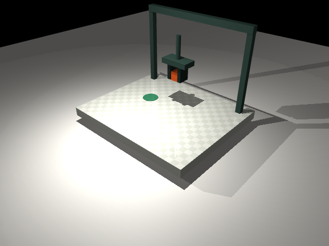

# Pickplace Lab · 部署鲁棒性与失败分析

一个状态输入的机器人模仿学习项目，覆盖自建 MuJoCo 抓取搬运与 robosuite Panda Lift，保留 **22,100 个正式评测回合、33 个模型权重、冻结协议和失败重放**。不同阶段的回合数只是工作量总和，不是同分布独立样本池。

**核心发现：** 固定 EMA 动作平滑在自建任务的 50 ms 指令延迟下将成功率从 56.0% 提高至 86.6%，但在 Panda Lift 上从 67.2% 降至 60.8%。结果支持研究适用边界，不支持宣称通用改进。

**English overview:** State-based imitation learning under deployment perturbations. This repository includes a custom MuJoCo pick-and-place task, a local robosuite Panda Lift replication, frozen protocols, checkpoints, per-episode records, and success/failure replays. A latency intervention helps one task but does not transfer at the prespecified 50 ms comparison. No vision, VLA, real-robot, leaderboard, or independent-replication claim is made.

**教学任务：** 平行夹爪在 MuJoCo 中抓起方块，搬到目标区域，释放并退开。
**方法：** 状态输入的行为克隆（BC），附 32/256 条示范的数据量对照、DAgger 纠正学习和部署扰动研究。
**边界：** 教学任务是三轴笛卡尔夹爪；Panda 是另行训练的七关节机械臂仿真任务。两者均无图像输入、VLA、语言指令或真机验证。



## 立即运行

仓库包含数据集、训练权重和评测结果，**不包含虚拟环境**。只看完整研究页面不需要安装机器学习依赖：

```bash
git clone https://github.com/liangqianxing/embodied-pickplace-lab.git
cd embodied-pickplace-lab
python3 -m http.server 8766 --bind 127.0.0.1 --directory artifacts/study/v1
```

浏览器访问 `http://127.0.0.1:8766`。运行真实新场景推理则先安装原项目的隔离环境，无需重新训练：

```bash
python3.11 -m venv .venv
.venv/bin/python -m pip install -r requirements-lock.txt
.venv/bin/python -m pip install -e . --no-deps
.venv/bin/pickplace serve --port 8765
```

浏览器访问 `http://127.0.0.1:8765`。

页面支持：查看真实评测指标、播放成功/失败轨迹、拖动时间轴、切换速度、查看 MuJoCo 实际渲染，以及选择策略、位置分布和种子后**重新运行仿真与模型推理**。新试跑不写入正式评测，不会改变论文式结果表。

Python 3.11 / macOS Apple Silicon 是已验证的原始环境；其他平台不能据此声称逐位复现。Panda 使用另一套隔离依赖，见 [Panda 安装与复验说明](benchmarks/robosuite/README.md)，不要混装。

## 许可、来源与反馈

- 项目原创内容以 [MIT](LICENSE) 许可发布；上游软件和模型资产保留各自许可，见 [第三方说明](THIRD_PARTY_NOTICES.md)。
- 项目开发与材料整理使用了 AI 辅助；实验数字来自保存的运行产物，不把 AI 辅助工作无条件表述为个人独立研究。
- 公开代码不等于已有社区影响。独立复现、外部采用、论文发表和被采纳的上游贡献均未建立。
- 欢迎通过 [复现反馈](https://github.com/liangqianxing/embodied-pickplace-lab/issues/new?template=reproducibility.yml) 报告成功或失败；请注明提交版本、环境和执行命令，并移除个人路径与凭据。
- GitHub Actions 只检查文件清单与哈希，不重跑物理仿真，也不证明科学结论。完整验证范围见 [复现说明](docs/REPRODUCIBILITY.md)。

## 研究扩展：15,000 回合稳健性研究

教学版之外，已经完成五训练/数据子集种子、五模型、六部署条件的冻结协议实验。完整报告在 `artifacts/study/v1/REPORT.md`，可视化页面在 `artifacts/study/v1/index.html`。

- **保留负结果：** 相对坐标 + 噪声增强没有改善预先指定的平均扰动成功率，较 BC32 低 7.72 个百分点；探索性配对双轴 bootstrap 95% 区间为 [-12.60, -2.68] pp。
- **可复查观察：** BC256 在干净条件下五次训练均 100%，加入 50 ms 指令延迟后平均降至 49.6%（跨训练运行 SD 17.8%）。这不是“更多数据导致退化”的因果结论。
- **保存证据：** 25 个研究权重、15,000 条逐回合记录、271 个确定性复跑核对过的成功/失败轨迹、17 个源代码/配置快照。
- **明确边界：** 自建状态任务，非视觉或真机结果；五个种子同时改变训练子集和优化随机性，区间仅供探索性分析。

```bash
# 研究页面；与交互仿真页面分开
.venv/bin/python -m http.server 8766 --bind 127.0.0.1 --directory artifacts/study/v1
# 浏览器访问 http://127.0.0.1:8766

# 验证与复现
.venv/bin/python scripts/verify_study.py
bash scripts/run_research.sh
```

详细协议、结论边界与求职表述分别见 `docs/RESEARCH_PROTOCOL.md`、`docs/RESEARCH_NOTE.md`、`docs/PORTFOLIO.md`。Panda 标准机械臂任务的本地复验已完成，但第三方复现与公开影响力仍未完成，详见 `docs/GOAL_AUDIT.md`，不能把本地研究页当作已有外部采用。

## 后续干预：固定权重的 50 ms 时延缓解

在研究 v1 发现时延敏感后，另行固定协议、使用新场景种子完成 **4,500 回合**对照。保持 BC256 权重不变，仅对平移动作使用系数 0.5 的指数平滑（EMA）：

| 执行方式 | 干净条件 | 50 ms 时延 | 100 ms 时延 |
|---|---:|---:|---:|
| 原始执行 | 100.0% | 56.0% | 52.4% |
| XYZ 增益减半 | 36.6% | 84.0% | 88.6% |
| EMA(0.5) | 99.6% | 86.6% | 40.6% |

50 ms 主比较提升 **30.6 个百分点**，探索性配对 bootstrap 95% 区间 [+17.0, +42.6] pp；干净条件下降 0.4 pp。**100 ms 下 EMA 退化**，增益减半也明显损伤干净表现，不能只展示正结果。这是标准滤波方法的工程验证，不宣称新算法或安全保证。

报告、冻结协议、原始回合和自动选择的改进/退化配对在 `benchmarks/latency_guard/`。实际 MuJoCo 对照动画为 `benchmarks/latency_guard/artifacts/v1/paired-delay-50ms.gif`，也已整合进研究页。原始 15,000 回合与后续 4,500 回合的场景和研究阶段不同，不能混成一张因果对照表。

## Panda 机械臂复验：不要把自建任务收益直接外推

已经在 robosuite 的七关节 Panda Lift 上另行训练五个状态策略，完成 **1,500 个学习策略回合 + 100 个基线回合**。128 条训练示范和 16 条验证示范来自这个任务，不复用自建夹爪的数据或权重。

| 执行条件 | 原始 BC 官方成功率 | EMA(0.5) 官方成功率 |
|---|---:|---:|
| 干净 | 100.0% | 77.2% |
| 50 ms 指令延迟 | 67.2% | 60.8% |
| 100 ms 指令延迟 | 70.8% | 77.6% |

50 ms 的预先指定主比较为 **-6.4 pp**，探索性配对区间 [-23.2, +10.4] pp，没有支持跨任务迁移。不要改用事后看到更好的 100 ms 结果来宣称主假设成功。官方抬升指标与连续保持 8 步的严格指标分开保存，55 条选定成功/失败轨迹已逐字段复跑核对。

这是**本地标准任务复验**，不是第三方独立验证。200 控制步 horizon、固定旋转动作和提前终止规则不等同标准榜单协议。没有视觉、VLA、真机或安全认证。

详见 `benchmarks/robosuite/README.md` 和 `benchmarks/robosuite/artifacts/study-v1_1/REPORT.md`；实际渲染在 `benchmarks/robosuite/artifacts/study-v1_1/media/panda-lift.gif`。隔离环境固定 robosuite 1.5.2 / MuJoCo 3.3.7，兼容性失败和修复过程保留在 `COMPATIBILITY.md`。

## 本次实际结果

每组 100 个独立测试回合；所有策略使用相同场景种子。不是只统计成功视频。

| 策略 | 同分布 | 新位置 OOD |
|---|---:|---:|
| 随机策略 | 0/100 | 0/100 |
| 脚本专家 | 100/100 | 100/100 |
| BC，32 条示范 | 96/100 | 66/100 |
| BC，256 条示范 | 100/100 | 100/100 |
| BC + DAgger，3 轮纠正 | 98/100 | 81/100 |

**结论：** 在这个简单、固定动力学的任务上，更多专家示范提高了本次新位置测试的表现；DAgger 没有进一步改善，反而退化。保留这一负结果，不把更复杂的方法包装成“必然更好”。

- 100/100 的 Wilson 95% 区间约为 **96.3%–100%**，不能解释为任意场景必然成功。
- 只有一个训练随机种子，置信区间反映测试回合的不确定性，不包含重新训练的方差。
- DAgger 多用了专家标注，不是等标注预算比较；没有进行超参数搜索或多随机种子显著性检验。
- OOD 只改变位置范围，**不代表**新物体、新光照、新材质或真机泛化。
- 完整逐回合结果、置信区间、失败分类见 `docs/EXPERIMENT.md` 和 `artifacts/results/evaluation.json`。
- README 的数字是本次交付快照；重跑后以重新生成的报告和仪表盘为准。

## 从零安装与复现

已验证环境：macOS Apple Silicon、Python 3.11.15。完整已安装版本见 `requirements-lock.txt`。

```bash
# 使用 Python 3.11 或兼容版本创建隔离环境
python3.11 -m venv .venv
.venv/bin/python -m pip install -r requirements-lock.txt
.venv/bin/python -m pip install -e . --no-deps

# 全流程；会覆盖本项目 artifacts 下的同名输出
bash scripts/run_all.sh
```

`requirements-lock.txt` 是本次 macOS/CPU 环境快照。其他平台可以改用 `pip install -e '.[dev]'` 解析兼容依赖，但这不等于跨平台数值逐位复现。Linux 无显示环境可尝试设置 `MUJOCO_GL=egl` 或安装 OSMesa；这是未在本机验证的迁移路径。只有生成 GIF 需要图形渲染，采集、训练、评测不需要渲染器。

也可逐步运行：

```bash
.venv/bin/pickplace collect
.venv/bin/pickplace train --episodes 32 --output artifacts/checkpoints/bc32.pt
.venv/bin/pickplace train                         # 256 条示范
.venv/bin/pickplace dagger                        # 3 × 64 条混合策略轨迹
.venv/bin/pickplace evaluate                      # 5 × 2 × 100 回合
.venv/bin/pickplace report
.venv/bin/pickplace render
.venv/bin/pytest -q
.venv/bin/ruff check src tests
.venv/bin/pickplace serve
```

所有计算都在本机 CPU 完成，不需要 GPU、API Key、云服务或付费模型。首次安装需要下载依赖；演示页面没有 CDN、在线字体或外部 JavaScript 依赖。

## 仿真设计

### 机器人与物理

- 三轴位置伺服控制的笛卡尔夹爪，两个独立滑动指爪，抓取自由刚体方块。
- 控制频率 20 Hz；MuJoCo 步长 0.002 s，每动作执行 25 个物理步。
- 方块边长 5 cm，质量 45 g；动作空间为 3 维位置增量和 1 维开合指令。
- 抓取靠接触摩擦，没有 weld、物体附着或执行过程中的强制位移。
- 位姿直接设置只出现在回合初始化与离线回放渲染中，**不用于执行策略或判定成功**。
- 最多 220 个控制步，即 11 秒仿真时间。

### 成功标准

必须先将物体中心抬到 10 cm 以上；随后物体中心距离目标 XY 小于 4.5 cm，处于桌面高度且平移速度低于 0.08 m/s，夹爪张开超过 7.5 cm 并退到 18 cm 高度以上；条件连续保持 8 个控制步才成功。仅把方块推到目标不算成功。

这是教学用宽松阈值，不是工业级装配精度。没有对物体朝向或角速度设置要求。

### 观测与策略

26 维观测：夹爪位置 3、物体位置 3、目标位置 3、物体相对夹爪位置 3、目标相对物体位置 3、夹爪开度 1、夹爪速度 3、物体平移速度 3、上一动作 4。

三层 128 宽 MLP；连续动作使用 tanh，开合使用二分类 logit；损失为位置动作 MSE + 0.15 × 开合 BCE。训练输入按训练集统计量标准化，以独立验证集的最低损失保存权重。学习策略不读取专家阶段或未来状态，也不在评测时调用专家。

专家是八阶段有限状态机：靠近 → 下降 → 闭合 → 抬升 → 搬运 → 下放 → 松开 → 退开。

### DAgger 实验

从 BC256 权重出发，在学习器/专家混合执行产生的状态上请求专家标签，每轮采集 64 回合；专家动作概率依次是 0.5、0.25、0.125，聚合数据后各训练 60 epoch。

该专家有内部阶段状态，且不是任意失败状态都能恢复；在偏离示范流形的状态上，其标签未必是可靠的最优纠正。当前实验没有证明这一点是性能退化的原因。下一步应检查保存的失败轨迹，增加 off-policy 验证与多种子重复，而不是据单次结果宣称 DAgger 无效。

## 数据与评测协议

| 用途 | 场景种子 |
|---|---|
| 专家训练集 | 0–255（小数据对照取前 32 条） |
| 验证集 | 10000–10031 |
| 开发时闭环检查 | 11000–11019，仅 BC32 和 BC256 |
| DAgger | 2000–2063、3000–3063、4000–4063 |
| 正式同分布测试 | 20000–20099 |
| 正式新位置测试 | 30000–30099 |
| 页面新试跑 | 默认 42000，可自定义；不纳入正式结果 |

- 先按整条轨迹划分训练与验证，避免相邻帧跨集合泄漏。
- ID 初始物体/目标位置范围：X ±0.16 m，Y ±0.12 m；物体和目标至少间隔 0.16 m。
- OOD 初始物体至少一轴落在训练范围外：X 绝对值 0.18–0.23 m 或 Y 绝对值 0.14–0.18 m；目标在更宽矩形内采样。
- 失败分为未抬升、偏离/掉落、释放/稳定；是末状态启发式标签，不是因果诊断。
- 回放固定选择每组首个成功和首个失败，代码自动选取。
- 后验报告不用于继续训练本次交付模型。

## 目录

```text
src/pickplace/
  assets/scene.xml      MuJoCo 模型、接触与执行器
  env.py                Gymnasium 环境与成功判据
  expert.py             脚本专家
  data.py               采集、轨迹划分、数据校验
  policy.py             PyTorch MLP、权重安全加载
  train.py              BC、DAgger 与验证集选择
  evaluate.py           配对评测、Wilson 区间、真实轨迹
  report.py             报告生成、MuJoCo GIF 渲染
  server.py             仅监听 loopback 的本地演示服务
  cli.py                可独立执行的命令
web/                    无构建依赖的响应式实验页面
artifacts/data/         示范数据与元信息
artifacts/checkpoints/  实际训练权重、逐 epoch 损失、DAgger 聚合数据
artifacts/results/      正式逐回合评测与回放
artifacts/media/        MuJoCo 实际渲染与页面验收截图
artifacts/runs/         本次运行日志
artifacts/manifest.json 交付文件 SHA-256 清单
scripts/run_all.sh      一键全流程
scripts/verify_artifacts.py 结果一致性与数据分离校验
scripts/build_manifest.py 交付清单生成
scripts/verify_manifest.py 交付文件校验
requirements-lock.txt  本次依赖版本
```

主测试集 37 项，另有 5 项滤波/基线一致性测试；覆盖 Gymnasium 接口、确定性、非法输入、动作裁剪、时间截断、真实接触、成功条件、分布外采样、数据隔离、训练降损、模型保存加载、确定性重训、置信区间和 HTTP 端点。Gymnasium 会提示速度观测的 Box 上下界为无穷；这是未对速度人为裁剪的明确声明。

本地服务仅绑定 `127.0.0.1`，只允许访问显式列出的页面与结果文件，防止暴露工程目录；不提供生产级鉴权，不应直接暴露到公网。多个同时运行的仿真请求返回 429。

## 可继续发展的方向

1. 多训练种子、多个数据子集重复实验，加入按场景配对的统计比较。
2. 加入相机图像与视觉编码器，先严格对比状态策略，避免混淆感知与控制误差。
3. 从单步 BC 扩展为动作序列预测，明确区别于完整 ACT/Transformer 实现。
4. 使用真实机械臂模型，加入关节限制、碰撞、相机标定与控制延迟。
5. 做质量、摩擦、观测噪声和遮挡随机化；最后再考虑真机和安全边界。

## 参考

- MuJoCo Python bindings: https://mujoco.readthedocs.io/en/stable/python.html
- Gymnasium custom environments: https://gymnasium.farama.org/introduction/create_custom_env/
- PyTorch saving/loading: https://docs.pytorch.org/tutorials/beginner/saving_loading_models.html
- DAgger 原论文：Ross, Gordon, Bagnell. *A Reduction of Imitation Learning and Structured Prediction to No-Regret Online Learning*, AISTATS 2011. https://proceedings.mlr.press/v15/ross11a.html

本项目是独立的轻量教学实现，不是 ACT、Diffusion Policy、LeRobot 或 DAgger 官方代码的复现声明。
